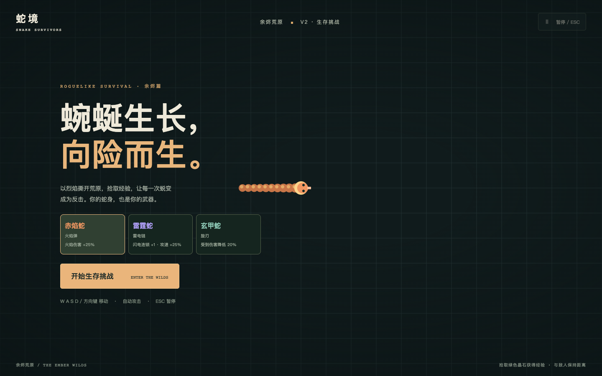
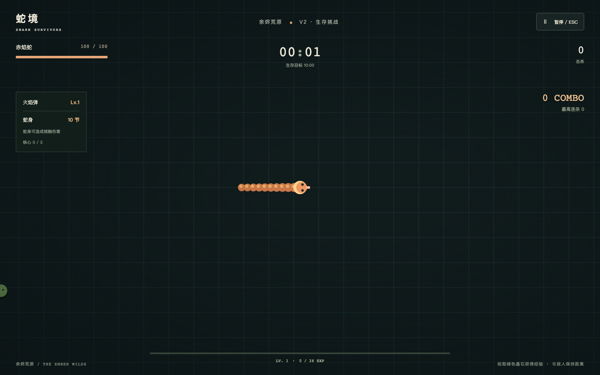

# 蛇境 · Snake Survivors

React + Canvas 的生存 Roguelike。当前交付阶段 **V2 完整战斗成长**，10 分钟生存挑战；V3 体验优化待进行。

## 运行

Node.js 20.19+（本地验证版本 23.11），npm 10+。

```sh
cd Task02/project/snake-survivors
npm ci
npm run dev
```

打开终端打印的本地地址。`npm test` 运行引擎测试，`npm run build` 输出静态文件到 dist，可部署到任意静态托管。

WASD / 方向键移动，自动攻击；ESC / 暂停按钮暂停继续。移动端拖动左下角摇杆。绿色经验晶石会在靠近时吸附；升级时游戏冻结，选一项继续。蛇身造成接触伤害。失焦自动暂停。

## 当前内容

三角色、轨迹插值战斗蛇身、四类普通敌人、精英与三阶段 Boss、五武器及等级、三种核心进化、限次属性升级、Combo/Fever、胜负结算、重启、响应式 HUD。无 API、无账户、无服务器和敏感配置。

架构和后续数值见 [技术方案](docs/ARCHITECTURE.md)，阶段结果见 [迭代记录](docs/CHANGELOG.md)。

## 截图




## 浏览器验收

`node tests/browser.mjs` 需要本机 Chrome（脚本使用 macOS 默认路径）及正在运行在 5173 端口的 dev 服务；其他系统请调整 executablePath。浏览器测试使用虚拟时钟推进游戏，不修改引擎生命或战斗数值。

## V2 玩法

赤焰蛇以火焰输出起步；雷霆蛇增加攻速与连锁；玄甲蛇使用旋刃并减伤。升级可获得全部五类武器、属性或核心。

| Lv.5 武器 | 所需核心 | 进化 |
| --- | --- | --- |
| 火焰弹 | 火焰核心 | 地狱火雨：多目标弹与燃烧区域 |
| 雷电链 | 能量核心 | 天罚雷暴：更多连锁与双倍基础伤害 |
| 旋刃 | 风之核心 | 虚空风暴：更多旋刃与更大半径 |

精英在 2、4、7 分钟出现，掉落稀有核心选择；Boss 在 9 分钟出现，生命低于 66% / 33% 切换阶段，落点红圈预警 0.9 秒。击败 Boss 或存活 10 分钟胜利。Boss 击杀恢复全部生命并获得胜利结算。

连杀间隔不能超过 3 秒，每 10 杀经验倍率 +0.1（上限 2）；30 连杀触发 6 秒 Fever，伤害 ×1.5、攻击频率 ×1.7，触发后 18 秒冷却。

## 验证边界与后续

17 项自动化测试通过。Chrome 验证开始、移动、暂停、死亡结算与重启、三角色切换、预置满级构筑的进化/Boss 场景，以及 390×844 布局。Boss 场景为测试预置，不代表已完成一局自然成长的 10 分钟通关；长期平衡与低端设备性能仍需 V3 实测。

V3：音效及静音、性能压力测试、真实移动设备触控验收与长局数值平衡。
